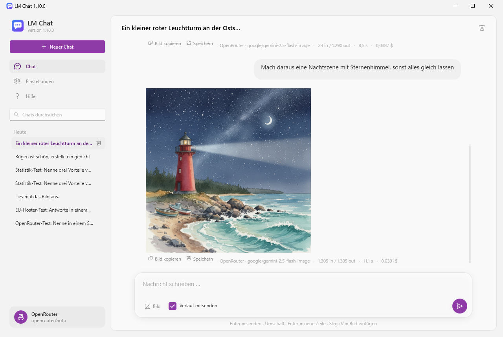
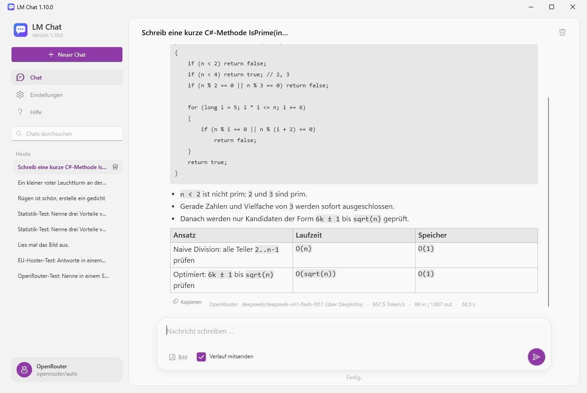
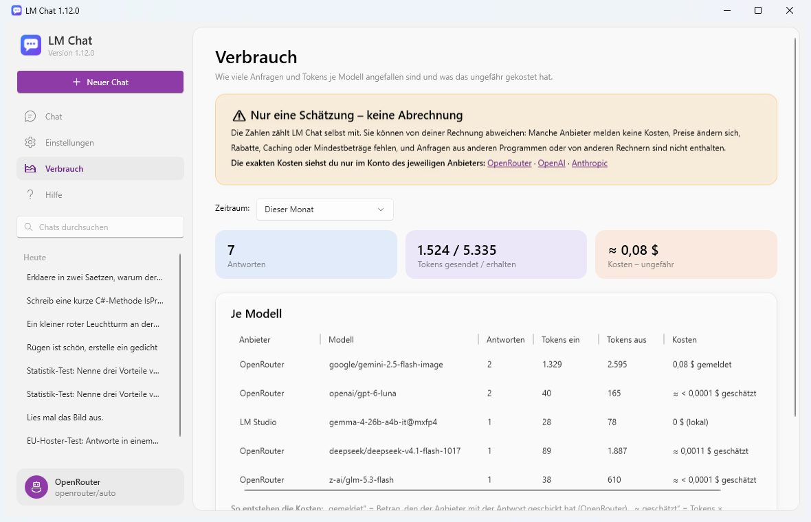
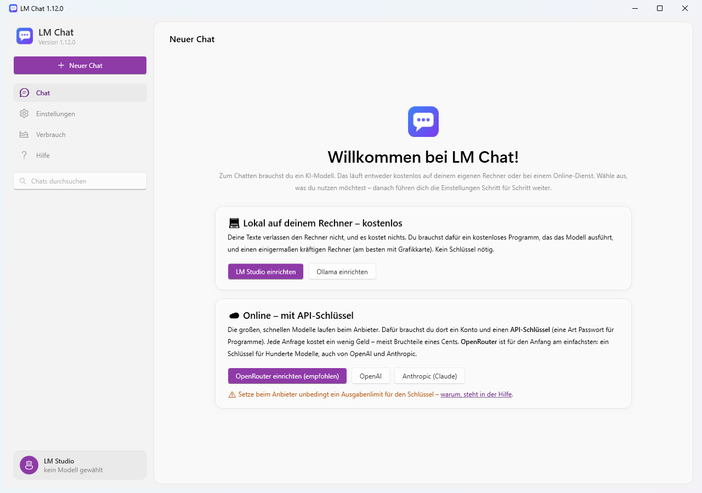
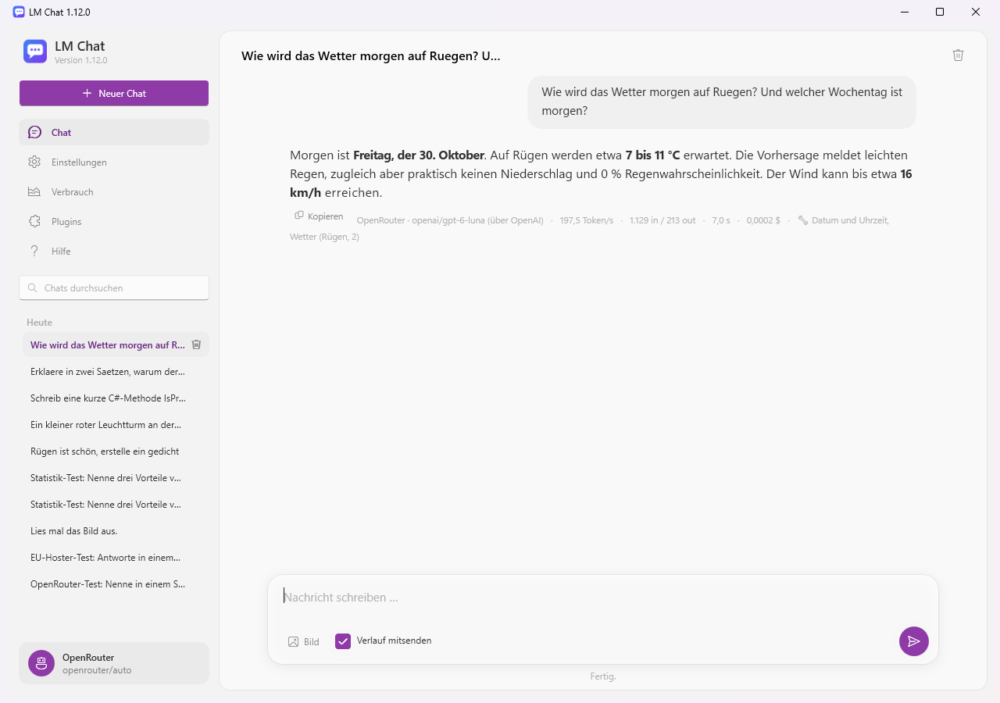
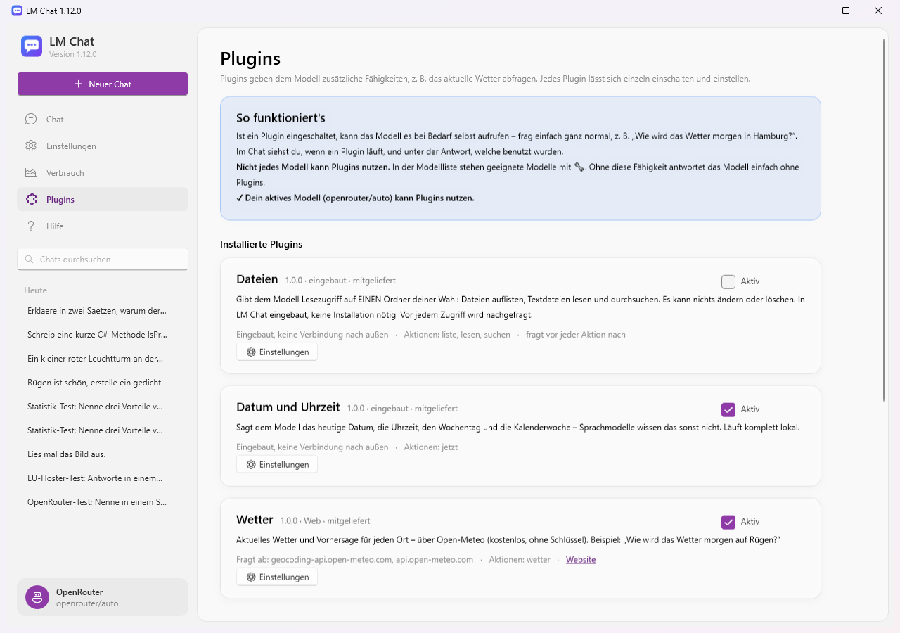

# FreeGuenther

*Früher „LM Chat“ (bis Version 1.17). Updates einfach drüberinstallieren: Der Installer ersetzt die alte App, und beim ersten Start übernimmt FreeGuenther Chats, Einstellungen und Plugins aus `%LOCALAPPDATA%\LmChat`.*

Ein einfacher Windows-Chat-Client für lokale und Online-Sprachmodelle: [LM Studio](https://lmstudio.ai), [Ollama](https://ollama.com), [OpenAI](https://platform.openai.com), [Anthropic (Claude)](https://platform.claude.com) und [OpenRouter](https://openrouter.ai). Er läuft als **eine einzige .exe** und braucht keine Installation und kein .NET auf dem Zielrechner.

**Projektseite:** [www.guentherhaslbeck.de/projekte/freeguenther](https://www.guentherhaslbeck.de/projekte/freeguenther/) (auch per Klick aufs Logo in der App)



*Bild erzeugen und per Folgeanweisung abändern, darunter Anbieter, Modell, Tokens, Dauer und Kosten.*



*Antworten werden als Markdown dargestellt: Code-Blöcke, Listen, Tabellen und Inline-Code.*



*Verbrauch je Modell: Antworten, Tokens und ungefähre Kosten. Das ist nur eine Schätzung, die exakten Kosten stehen im Konto des Anbieters.*



*Beim ersten Start: Auswahl, ob lokal oder online. Danach führen die Einstellungen Schritt für Schritt weiter.*



*Plugins: Das Modell ruft selbst „Datum und Uhrzeit“ und „Wetter“ auf. Unter der Antwort steht, welche Plugins benutzt wurden.*



*Plugin-Seite: Jedes Plugin lässt sich einzeln einschalten und einstellen, weitere kommen aus dem Katalog oder per Import.*

## Download

| Datei | Wofür |
|---|---|
| **[FreeGuenther-Setup.exe](https://github.com/ghaslbe/FreeGuenther/releases/latest/download/FreeGuenther-Setup.exe)** (Installer, empfohlen) | Installiert FreeGuenther mit Startmenü-Eintrag und optionalem Desktop-Symbol. Deinstallation über die Windows-Einstellungen. Keine Administratorrechte nötig, Updates einfach drüberinstallieren. |
| **[FreeGuenther.exe](https://github.com/ghaslbe/FreeGuenther/releases/latest/download/FreeGuenther.exe)** (portabel) | Ohne Installation, z. B. vom USB-Stick oder zum schnellen Ausprobieren. Herunterladen und starten. |

Beide Varianten sind dieselbe App und nutzen dieselben Chats und Einstellungen (`%LOCALAPPDATA%\FreeGuenther`). Alle Versionen findest du unter [Releases](https://github.com/ghaslbe/FreeGuenther/releases).

Hinweis: Die Dateien sind nicht digital signiert. Windows SmartScreen kann deshalb beim ersten Start warnen. Über „Weitere Informationen“ → „Trotzdem ausführen“ lässt sich die App starten.

## Funktionen

- **Mehrere Anbieter:** Jeder Anbieter merkt sich eigene Adresse, Schlüssel und Modell. In den Einstellungen gibt es zu jedem Anbieter Links zu Website, API-Schlüsseln, Modellen und Preisen.

  | Anbieter | Art | Standard-Adresse | Schlüssel |
  |---|---|---|---|
  | LM Studio | lokal | `http://localhost:1234` | – |
  | Ollama | lokal | `http://localhost:11434` | – |
  | OpenAI | online | `https://api.openai.com` | ja |
  | Anthropic (Claude) | online | `https://api.anthropic.com` | ja |
  | OpenRouter | online | `https://openrouter.ai/api` | ja |

  API-Schlüssel werden mit Windows DPAPI verschlüsselt gespeichert, nur für das eigene Windows-Konto lesbar.
- **OpenRouter: Standort der Rechenzentren:** Die Modellliste zeigt nur Modelle, die in der gewählten Region laufen. Es gibt zwei Wege:
  - **Über Hoster-Auswahl (Europa, Deutschland oder USA, jeder Tarif):** Die App ermittelt pro Modell die Hoster-Endpunkte mit bekanntem Standort. Grundlage ist die Region in der Endpunkt-Kennung, z. B. `mistral/eu`, `amazon-bedrock/eu-central-1` oder `google-vertex/us`, ersatzweise die Rechenzentrums-Länder des Hosters. Beim Senden lässt die App per `provider.only` nur diese Endpunkte zu und schaltet Ausweichhoster ab (`allow_fallbacks: false`). Die Standortangaben stammen von OpenRouter und den Hostern und sind nicht garantiert; Endpunkte wie `…/global` gelten als unbekannt und werden ausgeschlossen. Stand Oktober 2026 meldet kein Endpunkt einen Standort in Deutschland, die DE-Liste ist deshalb leer.
  - **Garantiert (Europa oder USA, nur Business-Tarif):** Anfragen gehen über `eu.openrouter.ai` bzw. `us.openrouter.ai` ([In-Region-Routing](https://openrouter.ai/docs/guides/features/sovereign-ai)). Ohne Business-Tarif antwortet OpenRouter mit HTTP 403.
- **Sprachen:** Deutsch, Englisch, Französisch, Spanisch und Italienisch. Standard ist die Sprache von Windows (sonst Englisch); umstellen geht in den Einstellungen ganz oben, ohne Neustart. Nicht übersetzt werden Plugins (Beschreibungen stammen aus der Plugin-Datei), eigene Vorlagen und der englische MIT-Lizenztext.
- **Zustimmung beim ersten Start:** Vor dem ersten Start bestätigt man „Ich stimme zu, dass ich diese Anwendung auf meine eigene Verantwortung nutze“, indem man **JA** eintippt (Schreibweise egal). Jede andere Eingabe oder „Beenden“ schließt die App. Die Zustimmung wird in der Datenbank gespeichert (`settings` → `consent`), danach kommt der Dialog nicht mehr.
- **Geführte Einrichtung:** Ist noch kein Modell eingerichtet, zeigt die Chat-Seite eine Willkommensseite. Dort wählst du „lokal“ (LM Studio, Ollama: kostenlos, kein Schlüssel) oder „online“ (OpenRouter empfohlen, OpenAI, Anthropic: mit API-Schlüssel und Ausgabenlimit). In den Einstellungen folgt eine Anleitung in 4 Schritten, die abhakt, was schon erledigt ist:
  1. Anbieter wählen
  2. Schlüssel eintragen bzw. Server starten
  3. Modell wählen
  4. Speichern

  Danach geht es mit „Los geht's – zum Chat“ weiter.
- **Chat mit Live-Antwort:** Die Antwort erscheint Wort für Wort (Streaming). Danach wird sie als **Markdown** dargestellt, mit Überschriften, Fettdruck, Listen, Tabellen, Codeblöcken und Links.
- **Was passiert gerade?** Bis der erste Text kommt, zeigt eine graue Zeile im Chat den Stand mit Sekundenzähler, z. B. „Anfrage an OpenRouter gesendet, warte auf Antwort … 3 s“. Die Phasen sind:
  - Hoster suchen (bei OpenRouter mit Regionsfilter)
  - Anfrage gesendet
  - Anfrage angenommen
  - „Das Modell denkt nach“ (wenn das Modell seine Denkphase mitschickt)

  Nach 30 Sekunden kommt ein Hinweis, bei lokalen Anbietern z. B., dass das Modell evtl. erst geladen wird. Sobald Text kommt, verschwindet die Zeile.
- **Verbrauch (eigene Seite):** Antworten, Tokens und ungefähre Kosten je Anbieter und Modell, wahlweise für heute, 7 Tage, diesen Monat, 30 Tage oder gesamt.
  - Die Kosten meldet OpenRouter mit der Antwort.
  - Für OpenAI, Anthropic und Antworten ohne Angabe schätzt die App sie aus Tokens × Listenpreis. Die Preise stammen aus der öffentlichen Preisliste von OpenRouter.
  - Lokale Anbieter kosten nichts.
  - Der Verbrauch bleibt beim Löschen eines Chats erhalten und lässt sich zurücksetzen.
  - **Das ist nur eine Schätzung.** Die exakten Kosten stehen im Konto des jeweiligen Anbieters ([OpenRouter](https://openrouter.ai/activity), [OpenAI](https://platform.openai.com/usage), [Anthropic](https://platform.claude.com/usage)).
- **Bilder erzeugen (OpenRouter, OpenAI):** Bildmodelle sind in der Modellliste mit 🎨 markiert, bei OpenRouter erkannt über `output_modalities` bzw. `/api/v1/images/models`, bei OpenAI `gpt-image-…` und `dall-e-…`.
  - Ist ein Bildmodell aktiv, ist die Nachricht die Bildbeschreibung. Angefragt wird über die Bild-Schnittstelle des Anbieters: `POST /api/v1/images` bzw. `/v1/images/generations`.
  - **Bearbeiten:** Ein angehängtes Bild dient als Vorlage, ohne Anhang (mit „Verlauf mitsenden“) das zuletzt erzeugte. So geht z. B. „mach daraus eine Nachtszene“. Technisch läuft das über `input_references` bzw. `/v1/images/edits`.
  - Das Bild erscheint im Chat, mit „Bild kopieren“, „Speichern“ (PNG) und den Kosten, sofern gemeldet. Erzeugte Bilder werden mit dem Chat gespeichert.
- **Kopieren:** Der Knopf „Kopieren“ unter jeder Antwort legt sie mit Markdown-Formatierung in die Zwischenablage. Code-Blöcke haben einen eigenen Knopf „Kopieren“, der nur den Code kopiert, und werden farbig hervorgehoben (Python, C#/Java/JS/Rust/Go u. a., Shell/PowerShell, SQL, JSON, HTML/XML).
- **Neu erzeugen:** Unter jeder Antwort stellt „Neu erzeugen“ dieselbe Frage nochmal, mit dem gerade eingestellten Modell. So lassen sich z. B. Modelle vergleichen. Die alte Antwort wird ersetzt.
- **Bearbeiten:** Unter jeder eigenen Nachricht holt „Bearbeiten“ sie zurück ins Eingabefeld. Die Nachricht und alles danach wird aus dem Chat entfernt; folgen noch weitere Nachrichten, fragt FreeGuenther vorher nach.
- **Gedankengang:** Schickt das Modell seine Denkphase mit (`reasoning`/`reasoning_content`, Claude-Thinking oder `<think>…</think>` im Text), läuft deren Ende während des Wartens in der Statuszeile mit. Danach steht sie eingeklappt über der Antwort und wird mit dem Chat gespeichert. An das Modell zurückgeschickt wird sie nicht.
- **Chat-Titel:** Nach der ersten Antwort schlägt das Modell einen kurzen Titel vor (abschaltbar in den Einstellungen unter „System-Prompt“). Bei Online-Anbietern kostet das ein paar Tokens; sie erscheinen unter „Verbrauch“.
- **Export:** Der Knopf oben rechts im Chat speichert ihn als Markdown oder als HTML. Bilder sind eingebettet, der Gedankengang ist im HTML aufklappbar. Die HTML-Datei lässt sich im Browser drucken bzw. als PDF speichern.
- **Scrollen:** Scrollt man während einer Antwort nach oben, springt der Chat nicht mehr ans Ende, bis man wieder ganz unten ist.
- **Dateien anhängen (PDF, Word, Text):** Über „Datei“, Strg+V oder Hineinziehen. FreeGuenther wandelt die Datei in Text um und schickt ihn mit der Nachricht mit:
  - PDF (über [PdfPig](https://github.com/UglyToad/PdfPig), Apache-2.0)
  - Word `.docx`
  - Text- und Code-Dateien (`.txt`, `.md`, `.csv`, `.json`, `.py`, `.cs` …)

  Über dem Eingabefeld steht je Datei ein Kärtchen mit der ungefähren Größe in Tokens. Ab etwa 8.000 Tokens kommt ein Hinweis, weil lokale Modelle oft nur einen kleinen Kontext haben. Sehr große Dateien werden nach 400.000 Zeichen gekürzt. Eingescannte PDFs ohne Texterkennung enthalten keinen Text. Die Dateien werden mit dem Chat gespeichert und bei weiteren Fragen im Verlauf mitgeschickt.
- **Vorlagen und Personas:** „/“ ins Eingabefeld tippen oder den Knopf „Vorlagen“ drücken, dann mit ↑↓ und Enter auswählen. Weitere Wörter nach dem „/“ filtern die Liste.
  - Eine **Vorlage** setzt ihren Text ins Eingabefeld, z. B. „Übersetze den folgenden Text ins Englische: …“.
  - Eine **Persona** gilt für den ganzen Chat als zusätzliche Anweisung zum System-Prompt, z. B. „Kurz und knapp“ oder „Einfach erklärt“. Sie steht als Kärtchen über dem Eingabefeld, wird mit dem Chat gespeichert und lässt sich dort wieder entfernen.

  Beispiele sind dabei; anlegen, ändern und löschen geht in den Einstellungen unter „Vorlagen und Personas“.
- **Modelle vergleichen (eigene Seite):** Dieselbe Frage geht gleichzeitig an zwei Modelle, auch an verschiedene Anbieter (z. B. lokal gegen online). Die Antworten stehen nebeneinander, darunter Dauer, Token/s, Tokens und Kosten (gemeldet, sonst nach Listenpreis geschätzt). Die Auswahl bleibt gespeichert; die Fragen landen nicht in der Chatliste, der Verbrauch wird aber mitgezählt.
- **Datei-Automatik (eigene Seite):** Ordner, Dateityp (alle Bilder jpg/jpeg/png/bmp, alle PDF, alle Excel `.xlsx`, alle Word `.docx`), Prompt, Ausgabeformat (txt, json, md), Prüfintervall in Sekunden sowie Anbieter und Modell wählen, dann „Starten“. Alle x Sekunden schaut FreeGuenther in den Ordner: Für jede neu abgelegte passende Datei ohne Ergebnis geht der Prompt samt Datei an das Modell, und daneben entsteht die Ergebnisdatei mit gleichem Namen und der Endung der Ausgabe (z. B. `rechnung.pdf` → `rechnung.json`).
  - Dateien, die beim Starten schon im Ordner liegen, werden übersprungen.
  - Eine Datei wird erst bearbeitet, wenn sie fertig geschrieben ist; schlägt sie dreimal fehl, wird sie bis zum nächsten Start übersprungen.
  - Bei JSON wird die Antwort geprüft; ist sie kein gültiges JSON, wird sie als Text in ein JSON-Objekt verpackt (Hinweis im Protokoll).
  - Bilder brauchen ein Modell, das Bilder versteht (🖼). Alte Formate `.doc` und `.xls` werden nicht gelesen.
  - Die Automatik läuft nur, solange FreeGuenther geöffnet ist, und läuft nach einem Neustart weiter, wenn sie aktiv war. Bei Online-Anbietern zählt sie zur Kostenbremse; ist ein Limit erreicht, hält sie an.
  - Die Eingaben bleiben auch ohne „Starten“ gespeichert (beim Wechseln der Seite und beim Beenden).
  - Ein Punkt im Menü zeigt den Zustand: rot = läuft, grau = aus (gilt auch für die E-Mail-Automatik).
- **E-Mail-Automatik (eigene Seite):** IMAP-Zugang (Server, Port, SSL/TLS oder STARTTLS, Benutzer, Passwort), Absender-Adresse, Prompt, Prüfintervall sowie Anbieter und Modell eintragen; „Verbindung testen“ prüft Zugang und Entwürfe-Ordner, dann „Starten“. Für jede neu ankommende Mail im Posteingang schreibt das Modell nach dem Prompt eine Antwort; sie landet als **Entwurf** im Ordner „Entwürfe“ (an den Absender, „Re: Betreff“, darunter die zitierte Mail).
  - **Gesendet wird nie automatisch** – Entwürfe prüft und verschickt man selbst im Mailprogramm. Empfänger und Betreff setzt FreeGuenther, nicht das Modell.
  - Nur Mails, die nach dem Starten ankommen, werden bearbeitet; die Original-Mail wird danach als gelesen markiert.
  - Anhänge (PDF, Word, Excel, Text) gehen mit an das Modell, Bilder nur bei Modellen mit Bilderkennung (das erste Bild). Andere Anhänge, z. B. Programme, werden nicht geöffnet.
  - Das Passwort wird mit Windows (DPAPI) verschlüsselt gespeichert und ist nur im eigenen Windows-Konto lesbar.
- **Schutz vor versteckten Anweisungen (Prompt-Injection):** Mails, Anhänge und Dateien stammen von Fremden und können versteckte Befehle an das Modell enthalten (z. B. weiße Schrift: „Ignoriere alle Anweisungen …“). FreeGuenther behandelt solche Inhalte nur als Daten:
  - Sie gehen klar markiert als fremde Daten an das Modell, mit festen Sicherheitsregeln im System-Prompt; gefälschte Markierungen und unsichtbare Zeichen werden entfernt.
  - In den Automatiken bekommt das Modell keine Werkzeuge (Plugins) – es kann also nichts ausführen, senden oder löschen.
  - Typische Angriffsmuster (in fünf Sprachen) und versteckter Text in HTML-Mails werden erkannt; dann steht eine Warnung oben im Entwurf bzw. in der Ergebnisdatei und im Protokoll.
  - Einen hundertprozentigen Schutz gibt es nicht: Ergebnisse immer prüfen, bevor man sie weiterverwendet.
- **Kostenbremse (auf der Seite „Verbrauch“):** Ein eigenes Tages- und/oder Monatsbudget in US-Dollar für alle Online-Anbieter zusammen. Ab 80 % kommt ein Hinweis. Ist das Limit erreicht, fragt FreeGuenther vor jeder Anfrage an einen Online-Anbieter nach; mit „Hart sperren“ wird ohne Nachfrage nichts mehr gesendet. Lokale Modelle sind nie betroffen. Grundlage ist dieselbe Schätzung wie auf der Verbrauchsseite – das ersetzt nicht das Ausgabenlimit beim Anbieter.
- **Angaben unter jeder Antwort** (klein, wird mit dem Chat gespeichert):
  - Anbieter und tatsächlich antwortendes Modell, bei OpenRouter auch der Hoster, z. B. `OpenRouter · openai/gpt-6-luna (über OpenAI)`
  - Token pro Sekunde (gemessen ab dem ersten Text- bzw. Denk-Token)
  - Tokens in/out, soweit der Anbieter sie meldet
  - Gesamtdauer
  - Kosten, soweit der Anbieter sie meldet (OpenRouter)

  Die Token-Zahlen stammen bei OpenAI-kompatiblen Anbietern aus `stream_options.include_usage`, bei Anthropic aus den Stream-Ereignissen der Messages API.
- **Gespeicherte Chats:** Jeder Chat wird in einer SQLite-Datenbank gespeichert und lässt sich links in der Liste wieder aufrufen. Löschen geht über den Papierkorb in der Liste (beim Darüberfahren), per Rechtsklick, mit der Entf-Taste oder oben rechts im geöffneten Chat, jeweils mit Sicherheitsabfrage.
- **„Bisherigen Chatverlauf mitsenden“:** Das Häkchen ist standardmäßig an, so kann man ein Gespräch führen. Ohne Häkchen wird nur die aktuelle Nachricht gesendet.
- **Bilder senden:** Bei Modellen, die Bilder verstehen (in LM Studio Typ `vlm`), lässt sich ein Bild anhängen, z. B. mit der Frage „Lies mal das Bild aus“. Dafür gibt es drei Wege:
  - Button **Bild …**
  - **Strg+V** (Screenshot oder kopierte Bilddatei)
  - Bilddatei ins Fenster ziehen

  Große Bilder werden automatisch auf maximal 2048 px verkleinert. Im Chat erscheint eine Vorschau, ein Klick darauf öffnet das Bild in voller Größe.
- **Einstellungen (eigene Seite):**
  - Links die Liste aller Anbieter mit ihrem Stand, z. B. „Schlüssel ✓ · openrouter/auto“ oder „kein Schlüssel“; „● im Chat“ markiert den Anbieter, der gerade antwortet. Ein Klick zeigt rechts dessen Einstellungen.
  - „Speichern“ speichert, ohne den Anbieter im Chat zu wechseln. So lässt sich z. B. ein OpenRouter-Schlüssel hinterlegen, während weiter LM Studio antwortet. Umschalten geht mit „Im Chat verwenden“. Ausnahme beim ersten Einrichten: Ist noch nichts fertig, wird der erste vollständige Anbieter automatisch verwendet.
  - Server-Adresse (wird beim Speichern geprüft)
  - Modell per Dropdown, direkt vom Anbieter geladen. 🎨 = erzeugt Bilder, 🖼 = versteht Bilder, ● = gerade geladen.
  - Darüber ein **Filter**: ein Suchfeld (alle Wörter müssen im Namen vorkommen, z. B. „gemini flash“) und eine Auswahl „Alle Modelle“, „Erzeugt Bilder“, „Versteht Bilder“ oder „Gerade geladen“. Daneben steht, wie viele Modelle passen.
  - System-Prompt
  - Temperatur, Top-P, Top-K, maximale Antwortlänge und Wiederholungsstrafe

  Die Zahlenwerte stellst du per Schieberegler ein, nur innerhalb gültiger Bereiche und jeweils mit Erklärung. Ohne Haken gilt der Standardwert des Modells.
- **Plugins (eigene Seite):** geben dem Modell zusätzliche Fähigkeiten über Tool Calling. Alles ist in die .exe eingebaut, es muss nichts zusätzlich installiert werden.
  - **Einzeln einschaltbar**, jedes Plugin mit eigener **Einstellungsseite**. Die Felder legt das Plugin selbst fest, z. B. Standardort, Einheiten, Ordner oder Schlüssel. Schlüssel werden verschlüsselt gespeichert.
  - **Mitgeliefert:**
    - **Wetter:** Open-Meteo, kostenlos, ohne Schlüssel
    - **Datum und Uhrzeit:** läuft lokal
    - **Dateien:** liest nur in einem freigegebenen Ordner, mit Rückfrage
    - **Webseite abrufen (GET):** lädt eine Adresse. Webseiten werden zu lesbarem Text, JSON und Text kommen unverändert. Optional lässt sich eine Liste erlaubter Domains einstellen, und Adressen im lokalen Netz sind standardmäßig gesperrt.
    - **Webhook (POST):** schickt eine Antwort als JSON an eine Adresse deiner Wahl, z. B. n8n, Make, Zapier, Home Assistant oder einen eigenen Server. Das geht per Knopf „Senden“ unter jeder Antwort oder per Chat („Schick die letzte Antwort an den Webhook“), dann mit Rückfrage. Ein optionaler Schlüssel wird als `Authorization: Bearer …` mitgeschickt. Format:

      ```json
      {
        "app": "FreeGuenther", "appVersion": "1.14.0", "sentAt": "2026-10-29T13:26:06+01:00",
        "chat": "Titel des Chats", "type": "text | image | text+image",
        "question": "die Frage dazu", "text": "die Antwort (Markdown)",
        "image": { "mimeType": "image/png", "base64": "…" },
        "provider": "OpenRouter", "model": "google/gemini-2.5-flash-image", "note": "optionale Notiz"
      }
      ```
  - **Weitere herunterladen:** aus dem [Plugin-Katalog](plugins/) (z. B. Wikipedia, Währungsrechner, DeepWiki per MCP), per Datei-Import oder von einer https-Adresse. Vor der Installation zeigt FreeGuenther, worauf das Plugin zugreift.
  - **MCP:** Plugins vom Typ MCP binden einen MCP-Server an, per URL (Streamable HTTP) oder als lokales Programm (stdio). Die Anbindung nutzt das offizielle C#-SDK `ModelContextProtocol`. Vor jeder Aktion fragt FreeGuenther nach.
  - **Unterstützte Anbieter:** alle (OpenAI-kompatibel über `tools`/`tool_calls`, Anthropic über `tool_use`), mit bis zu 8 Werkzeugrunden pro Antwort. Ob ein Modell Werkzeuge kann, erkennt die App:
    - LM Studio: `tool_use`
    - Ollama: `tools`
    - OpenRouter: `supported_parameters`

    Geeignete Modelle sind in der Liste mit 🔧 markiert. Lehnt ein Modell Werkzeuge ab, kommt die Antwort automatisch ohne Plugins.
  - Im Chat zeigt die Statuszeile „🔧 Wetter: …“ bzw. „❓ Warte auf deine Bestätigung“. Unter der Antwort steht, welche Plugins benutzt wurden.
  - Eigene Plugins schreiben: siehe [plugins/README.md](plugins/README.md).
- **Hilfe-Seite:** Kurzanleitung, Fehlerbehebung, Lizenz, Link zur [Projektseite](https://www.guentherhaslbeck.de/projekte/freeguenther/) und zur neuesten Version.
- **Oberfläche:**
  - Seitenleiste mit Logo, Navigation (Chat, Einstellungen, Hilfe), Suchfeld und nach Datum gruppierter Chatliste (Heute, Gestern, Letzte 7 Tage …). Unten zeigt eine Karte den aktiven Anbieter und das Modell.
  - Chat in einer mittigen Lesespalte: eigene Nachrichten als Sprechblasen, Antworten als Fließtext. Ein leerer Chat zeigt eine Startansicht.
  - Eingabe in einer abgerundeten Karte mit Bild-Knopf, „Verlauf mitsenden“ und rundem Senden-Knopf.
  - Einstellungen und Hilfe als Karten, oben in den Einstellungen Kacheln für Anbieter, Modell und Anzahl der Chats.
  - Die App folgt dem Hell- oder Dunkelmodus und der Akzentfarbe von Windows 11 (Fluent).

## Bedienung

| Taste | Aktion |
|---|---|
| Enter | Senden |
| Umschalt+Enter | Neue Zeile |
| Strg+V | Bild oder kopierte Dateien aus der Zwischenablage anhängen |
| / | Vorlagen und Personas auswählen (↑↓, Enter, Esc) |

## ⚠ Wichtig: Kosten absichern

Ein API-Schlüssel ist wie eine Kreditkarte. **Setze bei jedem Schlüssel bzw. Konto unbedingt ein Ausgabenlimit**, bevor du ihn in FreeGuenther einträgst:

- **OpenRouter:** Jeder Schlüssel kann ein eigenes Guthaben-Limit bekommen ([Schlüssel verwalten](https://openrouter.ai/settings/keys)). Nur so viel Guthaben aufladen wie nötig, automatisches Aufladen ausschalten.
- **OpenAI:** Budget bzw. Nutzungslimit in den Organisations-Einstellungen ([Limits](https://platform.openai.com/settings/organization/limits)). Automatisches Aufladen ausschalten.
- **Anthropic:** Ausgabenlimit in der Claude-Konsole ([Limits](https://platform.claude.com/settings/limits)).

Lege für FreeGuenther einen eigenen Schlüssel an, damit du ihn gezielt sperren kannst. Bei Verdacht auf Missbrauch löschst du ihn sofort beim Anbieter. Die App weist in der Hilfe und beim API-Schlüssel darauf hin, und in den Anbieter-Links steht „⚠ Ausgabenlimit setzen“.

## Einrichtung der Anbieter

**LM Studio:** Unter **Developer** den Server starten (Standard-Port `1234`). Für Zugriff von anderen Rechnern **„Serve on Local Network“** einschalten und gegebenenfalls den Port in der Firewall freigeben.

**Ollama:** Modelle mit `ollama pull <name>` laden. Für Zugriff von anderen Rechnern Ollama mit `OLLAMA_HOST=0.0.0.0` starten.

**OpenAI, Anthropic, OpenRouter:** API-Schlüssel im Konto des Anbieters erzeugen und in den Einstellungen eintragen. Die Nutzung kostet je nach Modell Geld. Nachrichten und Bilder werden an den Dienst gesendet.

## Technische Details

| Anbieter | Chat | Modellliste | Bilderkennung |
|---|---|---|---|
| LM Studio | `/v1/chat/completions` (OpenAI-kompatibel) | `/api/v0/models` | Typ `vlm` |
| Ollama | `/v1/chat/completions` (OpenAI-kompatibel) | `/api/tags` und `/api/show` | Fähigkeit `vision` |
| OpenAI | `/v1/chat/completions` | `/v1/models` | wird nicht gemeldet |
| OpenRouter | `/api/v1/chat/completions` | `/api/v1/models` | `input_modalities` enthält `image` |
| Anthropic | offizielles [Anthropic-SDK für C#](https://www.nuget.org/packages/Anthropic) (Messages API, Streaming) | Models API | alle Claude-Modelle |

Welche Feineinstellungen gesendet werden, hängt vom Anbieter ab. Nicht unterstützte Einstellungen sind ausgegraut und werden nicht gesendet; bei Anthropic sind das z. B. Temperatur, Top-P und Top-K. Bei aktuellen Claude-Modellen (Opus 5.5, Opus 5, Fable 5.1, Sonnet 5.5) ist der serverseitige Fallback aktiv: Lehnt das Modell eine Anfrage ab, antwortet automatisch ein passendes Ersatzmodell.

## Daten

Chats und Einstellungen liegen nur lokal in:

```
%LOCALAPPDATA%\FreeGuenther\chats.db
```

Die SQLite-Datenbank hat vier Tabellen:

- `chats`
- `messages`: Bilder werden als PNG-BLOB gespeichert
- `settings`
- `usage`: Verbrauch je Antwort (Anbieter, Modell, Tokens, gemeldete Kosten), unabhängig von den Chats

Installierte Plugins liegen als JSON-Dateien in `%LOCALAPPDATA%\FreeGuenther\plugins`. Ihr Zustand (an/aus, Einstellungen) steht in der Datenbank unter `settings` → `plugins`.

## Versionen und Releases

Die Versionsnummer steht in `LmChat/LmChat.csproj` (`<Version>`) und wird bei jeder Änderung hochgezählt. Sie erscheint im Fenstertitel und in der Hilfe.

Bei jedem Push auf `main` baut GitHub Actions (`.github/workflows/release.yml`) die portable `FreeGuenther.exe` und mit [Inno Setup](https://jrsoftware.org/isinfo.php) den Installer `FreeGuenther-Setup.exe` (Skript: `installer/FreeGuenther.iss`). Beide landen im Release `v<Version>`. Gibt es das Release schon, werden nur die Dateien ersetzt.

Installer lokal bauen (nach `dotnet publish`):

```
ISCC.exe /DAppVersion=1.10.0 installer\FreeGuenther.iss
```

## Bauen

Benötigt wird das [.NET 10 SDK](https://dotnet.microsoft.com/download):

```
winget install Microsoft.DotNet.SDK.10
```

Zum Entwickeln und Starten:

```
dotnet run --project LmChat
```

Eigenständige Einzel-.exe erzeugen:

```
dotnet publish LmChat -c Release -o LmChat\publish -p:DebugType=none
```

Ergebnis: `LmChat\publish\FreeGuenther.exe` (ca. 63 MB, enthält die .NET-Laufzeit).

Das Icon erzeugt `tools\make-icon.ps1` neu.

Zum Testen mit einer anderen bzw. leeren Datenbank (z. B. für die Willkommensseite) die Umgebungsvariable `FREEGUENTHER_DB` setzen:

```
$env:FREEGUENTHER_DB = "$env:TEMP\freeguenther-test.db"; .\LmChat\publish\FreeGuenther.exe
```

## Projektaufbau

| Datei | Inhalt |
|---|---|
| `LmChat/MainWindow.xaml` | Oberfläche: Chat, Einstellungen, Hilfe |
| `LmChat/MainWindow.xaml.cs` | Logik: Chat, Bilder, Chatliste, Einstellungsseite |
| `LmChat/MainWindow.Plugins.cs` | Plugin-Seite: Liste, Einstellungen je Plugin, Katalog, Import |
| `LmChat/L.cs` | Mehrsprachigkeit: `L.T("deutscher Text")`, `L.F("… {0} …", wert)` und Laden der Sprache |
| `LmChat/Lang/*.json` | Übersetzungen (`de.json` = Oberflächentexte `ui.…`, die anderen zusätzlich die Texte aus dem Code mit dem deutschen Text als Schlüssel) |
| `LmChat/MainWindow.Language.cs` | Sprachauswahl und Neubeschriften nach einem Wechsel |
| `LmChat/MainWindow.Compare.cs` | Seite „Modelle vergleichen“ |
| `LmChat/MainWindow.Automation.cs` | Seite „Datei-Automatik“: Ordner prüfen, Dateien bearbeiten, Protokoll |
| `LmChat/AutomationJob.cs` | Auftrag der Datei-Automatik (gespeichert unter `settings` → `automation`) und Ausgabeformate |
| `LmChat/MainWindow.Mail.cs` | Seite „E-Mail-Automatik“: IMAP-Verbindung, neue Mails bearbeiten, Entwürfe ablegen, Protokoll |
| `LmChat/MailJob.cs` | Auftrag der E-Mail-Automatik (gespeichert unter `settings` → `mail`), Mail auslesen, Antwort-Entwurf bauen |
| `LmChat/PromptGuard.cs` | Schutz vor Prompt-Injection: Sicherheitsregeln, Markierung fremder Daten, Erkennung von Angriffsmustern |
| `LmChat/MainWindow.Budget.cs` | Kostenbremse und Kostenberechnung (auch für die Verbrauchsseite) |
| `LmChat/MainWindow.Templates.cs` | Vorlagen und Personas: Auswahl mit „/“, Verwaltung in den Einstellungen |
| `LmChat/MainWindow.Documents.cs` | Dateien anhängen (Kärtchen, Hineinziehen, Zwischenablage) |
| `LmChat/DocumentReader.cs` | PDF, Word und Textdateien → Text |
| `LmChat/CodeHighlighter.cs` | Farbige Hervorhebung in Code-Blöcken |
| `LmChat/Plugins.cs` | Plugin-Manifest, Laden/Installieren, Ausführen (Web, eingebaut, MCP) |
| `plugins/` | Plugin-Katalog (`index.json`) und Plugin-Dateien, Anleitung für eigene Plugins |
| `LmChat/Providers.cs` | Anbieter (Standardwerte, Links) und `LlmClient`: Modelllisten und Streaming je Anbieter |
| `LmChat/MarkdownRenderer.cs` | Markdown → WPF-FlowDocument (über Markdig) |
| `LmChat/ParamRow.cs` | Einstellungszeile mit Haken, Erklärung und Schieberegler |
| `LmChat/ChatStore.cs` | SQLite-Speicher für Chats, Nachrichten, Einstellungen |
| `LmChat/LlmSettings.cs` | Einstellungen je Anbieter (als JSON in der Datenbank, Schlüssel per DPAPI verschlüsselt) |
| `LmChat/app.ico` | App-Icon |

Technik: C# / WPF auf .NET 10, `Microsoft.Data.Sqlite`, `Markdig`, `Anthropic`, `ModelContextProtocol`, `PdfPig`, `System.Security.Cryptography.ProtectedData`.

## Lizenz und Haftungsausschluss

Dieses Projekt steht unter der [MIT-Lizenz](LICENSE). Du darfst es frei nutzen, verändern und weitergeben.

Die Software wird **ohne jede Gewährleistung** bereitgestellt. Die Autoren übernehmen **keinerlei Haftung** für Schäden, Datenverlust oder sonstige Folgen der Nutzung. Antworten von KI-Modellen können falsch sein. Prüfe wichtige Informationen selbst.
